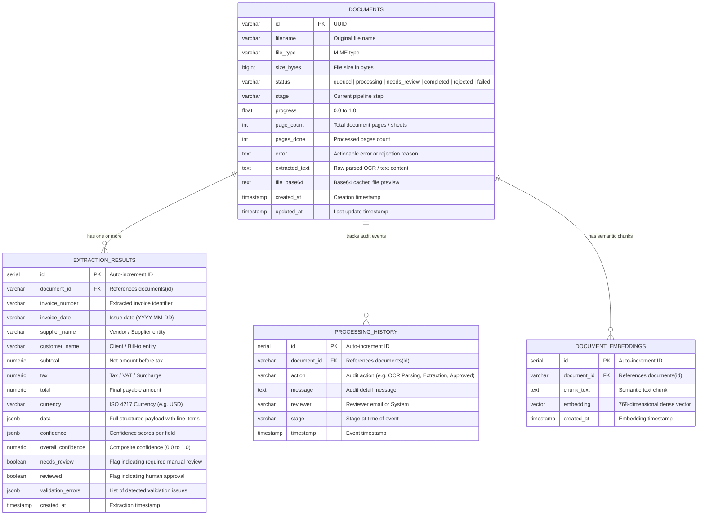

# DocuIntel — System Architecture & Database Schema Specification

This document details the complete end-to-end system architecture, processing pipeline, and relational/vector database schema for the **DocuIntel Document Intelligence Platform**.

---

## 1. High-Level Architecture Diagram

```mermaid
flowchart TD
    subgraph Frontend["Modern Client Layer (Next.js 16 + Redux Toolkit)"]
        UI_Upload["Multi-File Upload Zone<br/>(Drag-and-Drop Batch)"]
        UI_Dashboard["Live Operations Dashboard<br/>(Real-Time Polling & Status Cards)"]
        UI_Viewer["Document & OCR Text Viewer<br/>(Side-by-Side Verification)"]
        UI_Review["Validation & Reconciliation View<br/>(Inline Editing, 1-Click Discrepancy Fixes)"]
        UI_Search["Smart Search & AI Document Analyst<br/>(Keyword, HNSW Vector, Grounded RAG)"]
    end

    subgraph API_Gateway["FastAPI Gateway Layer (Port 8000)"]
        FastAPI_App["FastAPI REST Engine<br/>(/api/v1/documents, /search, /stats)"]
        Background_Pool["Background Processing Worker Pool<br/>(Async Non-Blocking Ingestion)"]
    end

    subgraph Ingestion_Pipeline["Multi-Modal Parsing Pipeline"]
        Router["Format Classifier Router"]
        PyMuPDF["PyMuPDF Digital Extractor<br/>(Fast native PDF text)"]
        Vision_OCR["OpenAI GPT-4o-mini Vision<br/>(Scanned PDFs & Images)"]
        Spreadsheet_Parser["Openpyxl & Xlrd Engines<br/>(Multi-Sheet Excel & CSVs)"]
    end

    subgraph AI_Intelligence["Extraction & Enterprise Validation Layer"]
        LLM_Extractor["LangChain Structured Extraction<br/>(Pydantic Schema with Zero Hallucination)"]
        Dynamic_Classifier["Dynamic Document Classifier<br/>(Invoices vs Resumes, NDAs, Papers)"]
        Validation_Engine["Multi-Rule Validation Engine<br/>• Missing Fields<br/>• Numeric Validity<br/>• Duplicate Invoices<br/>• Arithmetic Reconciler"]
    end

    subgraph Storage_Layer["Supabase PostgreSQL & pgvector Database"]
        DB_Documents[("documents<br/>Metadata, Status, Stage, Extracted Text")]
        DB_Results[("extraction_results<br/>Header Fields, Line Items JSON, Issues")]
        DB_History[("processing_history<br/>Audit Trail & Reconciliation Logs")]
        DB_Embeddings[("document_embeddings<br/>768-Dim Dense Vectors + HNSW Index")]
    end

    subgraph Intelligence_Layer["RAG & Semantic Retrieval Engine"]
        Vector_Search["HNSW Cosine Similarity Query"]
        RAG_Synthesizer["Grounded Document Analyst<br/>(Synthesis with Direct Citations)"]
    end

    %% Flow Connections
    UI_Upload -->|Batch Multipart Upload| FastAPI_App
    FastAPI_App -->|Offload Task| Background_Pool
    Background_Pool --> Router
    Router -->|Digital PDF| PyMuPDF
    Router -->|Scanned PDF / Image| Vision_OCR
    Router -->|Excel / CSV| Spreadsheet_Parser

    PyMuPDF --> LLM_Extractor
    Vision_OCR --> LLM_Extractor
    Spreadsheet_Parser --> LLM_Extractor

    LLM_Extractor --> Dynamic_Classifier
    Dynamic_Classifier --> Validation_Engine

    Validation_Engine -->|If Valid Commercial Doc| DB_Results
    Validation_Engine -->|If Inconsistent| DB_Results
    Validation_Engine -->|Audit Logs| DB_History
    Validation_Engine -->|Sync Status| DB_Documents

    Validation_Engine -->|If Clean & Approved| DB_Embeddings

    UI_Dashboard <-->|REST Polling| FastAPI_App
    UI_Viewer <-->|REST API| FastAPI_App
    UI_Review -->|PATCH /api/results/{id}| FastAPI_App
    UI_Search -->|GET /api/v1/search/rag| FastAPI_App

    FastAPI_App <--> Vector_Search
    Vector_Search <--> DB_Embeddings
    Vector_Search --> RAG_Synthesizer
    RAG_Synthesizer --> UI_Search
```

---

## 2. Database Schema & Data Models

DocuIntel utilizes a robust PostgreSQL relational schema with Supabase `pgvector` extensions for high-dimensional vector search.

### Entity-Relationship Diagram



---

## 3. Database DDL (Schema Definition)

```sql
-- Enable pgvector extension for high-performance semantic retrieval
CREATE EXTENSION IF NOT EXISTS vector;

-- 1. Documents Core Table
CREATE TABLE IF NOT EXISTS documents (
    id VARCHAR(64) PRIMARY KEY,
    filename VARCHAR(255) NOT NULL,
    file_type VARCHAR(100) DEFAULT 'application/pdf',
    size_bytes BIGINT DEFAULT 0,
    status VARCHAR(32) DEFAULT 'queued',
    stage VARCHAR(64) DEFAULT 'Uploaded',
    progress FLOAT DEFAULT 0.0,
    page_count INT DEFAULT 1,
    pages_done INT DEFAULT 0,
    error TEXT,
    extracted_text TEXT,
    file_base64 TEXT,
    created_at TIMESTAMP WITH TIME ZONE DEFAULT NOW(),
    updated_at TIMESTAMP WITH TIME ZONE DEFAULT NOW()
);

CREATE INDEX IF NOT EXISTS idx_documents_status ON documents(status);
CREATE INDEX IF NOT EXISTS idx_documents_created ON documents(created_at DESC);

-- 2. Structured Extraction Results
CREATE TABLE IF NOT EXISTS extraction_results (
    id SERIAL PRIMARY KEY,
    document_id VARCHAR(64) REFERENCES documents(id) ON DELETE CASCADE,
    invoice_number VARCHAR(128),
    invoice_date VARCHAR(64),
    supplier_name VARCHAR(255),
    customer_name VARCHAR(255),
    subtotal NUMERIC(14, 2),
    tax NUMERIC(14, 2),
    total NUMERIC(14, 2),
    currency VARCHAR(16) DEFAULT 'USD',
    data JSONB DEFAULT '{}'::jsonb,
    confidence JSONB DEFAULT '{}'::jsonb,
    overall_confidence NUMERIC(5, 4) DEFAULT 0.95,
    needs_review BOOLEAN DEFAULT FALSE,
    reviewed BOOLEAN DEFAULT FALSE,
    validation_errors JSONB DEFAULT '[]'::jsonb,
    created_at TIMESTAMP WITH TIME ZONE DEFAULT NOW()
);

CREATE INDEX IF NOT EXISTS idx_results_doc_id ON extraction_results(document_id);
CREATE INDEX IF NOT EXISTS idx_results_inv_num ON extraction_results(invoice_number);
CREATE INDEX IF NOT EXISTS idx_results_supplier ON extraction_results(supplier_name);

-- 3. Processing & Audit History
CREATE TABLE IF NOT EXISTS processing_history (
    id SERIAL PRIMARY KEY,
    document_id VARCHAR(64) REFERENCES documents(id) ON DELETE CASCADE,
    action VARCHAR(128) NOT NULL,
    message TEXT NOT NULL,
    reviewer VARCHAR(128),
    stage VARCHAR(64),
    timestamp TIMESTAMP WITH TIME ZONE DEFAULT NOW()
);

CREATE INDEX IF NOT EXISTS idx_history_doc_id ON processing_history(document_id);

-- 4. Document Embeddings & HNSW Vector Index
CREATE TABLE IF NOT EXISTS document_embeddings (
    id SERIAL PRIMARY KEY,
    document_id VARCHAR(64) REFERENCES documents(id) ON DELETE CASCADE,
    chunk_text TEXT NOT NULL,
    embedding VECTOR(768) NOT NULL,
    created_at TIMESTAMP WITH TIME ZONE DEFAULT NOW()
);

CREATE INDEX IF NOT EXISTS idx_embeddings_doc_id ON document_embeddings(document_id);

-- HNSW Vector Index for Cosine Similarity Retrieval
CREATE INDEX IF NOT EXISTS idx_document_embeddings_hnsw 
ON document_embeddings USING hnsw (embedding vector_cosine_ops)
WITH (m = 16, ef_construction = 64);
```

