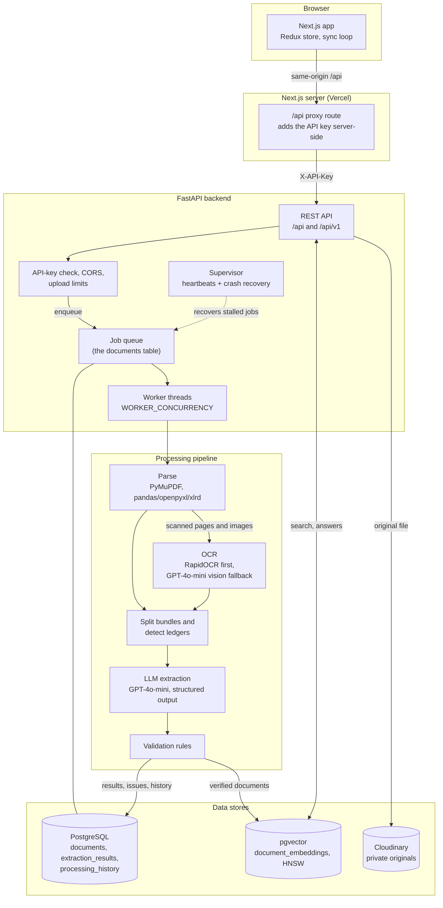
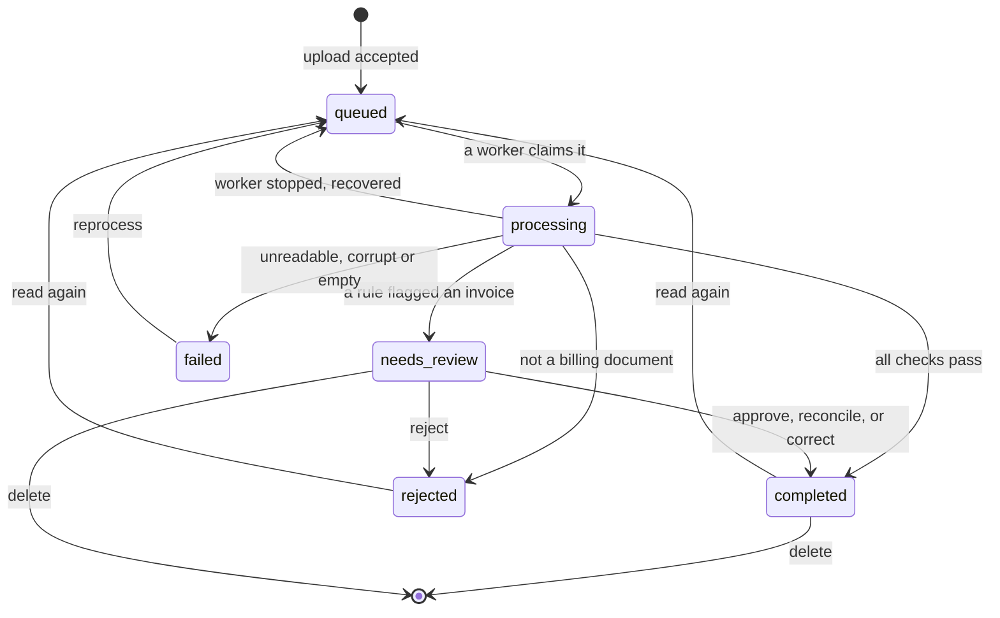
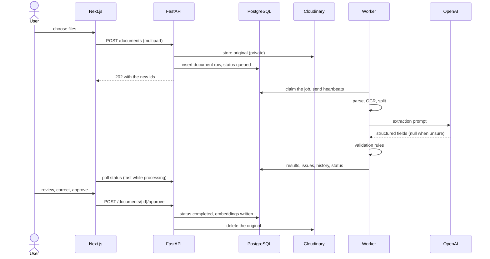
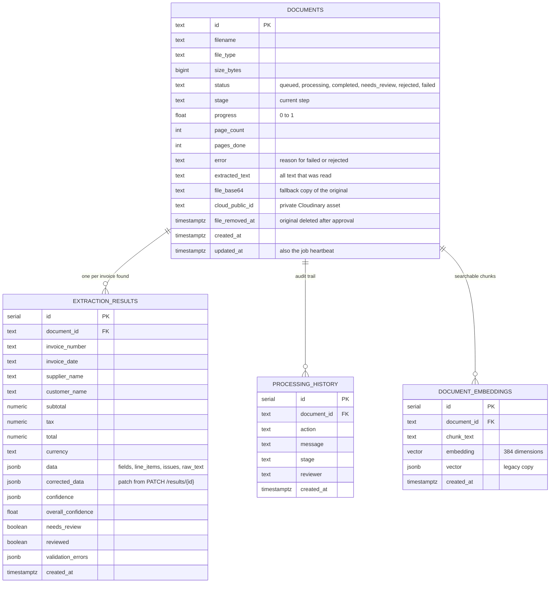

# DocuIntel: architecture and database schema

This document describes the system as it is built: the components, how a document moves through them, the database schema, and the reasons behind the main design choices. For setup and the API, see [`README.md`](README.md). For measured results, see [`EVALUATION_REPORT.md`](EVALUATION_REPORT.md).

**Contents:** [1. System overview](#1-system-overview) · [2. Document lifecycle](#2-document-lifecycle) · [3. Processing pipeline](#3-processing-pipeline) · [4. Durable job queue](#4-durable-job-queue) · [5. Validation](#5-validation) · [6. Search](#6-search) · [7. Cross-verification](#7-cross-verification) · [8. Storage of original files](#8-storage-of-original-files) · [9. Database schema](#9-database-schema) · [10. Security](#10-security) · [11. Frontend](#11-frontend) · [12. Quality attributes](#12-quality-attributes-speed-scale-reliability-security) · [13. Design decisions and alternatives](#13-design-decisions-and-alternatives)

---

## 1. System overview



**Component responsibilities**

| Component | Module(s) | Responsibility |
|---|---|---|
| REST API | `app/api/` | Upload, status, results, corrections, review decisions, reprocessing, search, cross-verification, statistics. |
| Security | `app/core/security.py`, `app/main.py` | API-key check (constant time), CORS allow-list. |
| Job queue | `app/services/job_queue.py` | Hands documents to a bounded worker pool, sends heartbeats, recovers stalled jobs. |
| Pipeline | `app/services/pipeline.py`, `extractor.py` | Runs a document from raw bytes to saved, validated results. |
| Parsing and OCR | `extractor.py`, `local_ocr.py`, `vision_ocr.py`, `spreadsheet.py` | Text from digital PDFs, scans and images, and spreadsheets. |
| Segmentation | `segmenter.py` | Splits one PDF into its invoices by invoice number. |
| Validation | `validator.py` | Deterministic rules over the extracted values. |
| Search | `search_service.py`, `rag_service.py` | Keyword, semantic and hybrid search, plus answers with citations. |
| Cross-verification | `cross_verify.py` | Compares two documents invoice by invoice. |
| Original files | `cloud_storage.py`, `page_render.py` | Private storage of the original while it awaits review, and page images for the preview. |
| Data access | `app/models/` | All SQL, with bound parameters. |

---

## 2. Document lifecycle

A document row is created at upload and carries its own state, so the same table is also the job queue (section 4).



| Status | Meaning |
|---|---|
| `queued` | Accepted, waiting for a worker (also after a re-run or a recovery). |
| `processing` | A worker is reading it. The `stage` column says where (for example `OCR & Parsing`, `Information Extraction`, `Vector Indexing`), and `progress` runs from 0 to 1. |
| `completed` | Passed every rule, or a reviewer approved it. Indexed for semantic search. |
| `needs_review` | At least one invoice was flagged. Held out of semantic search until a person decides. |
| `rejected` | The model classified it as not an invoice, waybill or receipt, with a specific reason. |
| `failed` | Could not be read (corrupt, empty, or an unrecoverable error), with the reason in `error`. |

When a document is approved, its stored original file is deleted (section 8). The extracted data, the page text and the search index stay.



---

## 3. Processing pipeline

| Input | Steps |
|---|---|
| **Digital PDF** | PyMuPDF extracts the text of every page (a 1,000-page PDF takes about 0.1 s). |
| **Scanned PDF** | Pages are rendered to images (up to `MAX_OCR_PAGES`, default 100) and read by OCR. |
| **Image** (JPG, PNG, TIFF, WEBP) | Upscaled to a readable size and read by OCR. |
| **OCR** | **RapidOCR** (PaddleOCR models on ONNX Runtime) runs on the server first. If its mean confidence is below `OCR_MIN_CONFIDENCE` (0.80), the **GPT-4o-mini vision model** re-reads the page, and the document is flagged `LOW_OCR_QUALITY`. Anything unreadable is written as `[illegible]`, never guessed. |
| **Excel / CSV** | Every sheet is read with pandas (openpyxl for `.xlsx`, xlrd for `.xls`). A sheet whose rows are invoices is detected as a **ledger** and parsed row by row **without the LLM**; other sheets are turned into text for extraction. |
| **Several invoices in one PDF** | The text is split at each printed invoice number, and every invoice is extracted and validated on its own (up to `MAX_INVOICES_PER_DOCUMENT`). |
| **Corrupt or empty** | A specific error is recorded and the status becomes `failed`. The worker never crashes. |

**Extraction.** The text of each invoice (its first 6,000 and last 4,000 characters by default) goes to GPT-4o-mini with a structured-output schema. Every field defaults to `null`, the prompt forbids guessing, and numbers are returned as plain floats. The result is a JSON object with the invoice number, date, supplier, customer, subtotal, tax, total, currency and line items. The full prompts are in the README.

**Result shape** (`extraction_results.data`, JSONB): the header fields, `line_items[]`, `issues[]` (validation findings), `raw_text`, and for bundles and ledgers `page_range` and `source`.

**Confidence** is a heuristic: the share of key fields found, capped by the real OCR confidence, and reduced when a rule flagged the invoice. It is a guide for reviewers, not a probability.

---

## 4. Durable job queue

There is **no separate job table and no Redis**. The `documents` row is the job.

- **Claiming and running.** `enqueue()` hands the document to a `ThreadPoolExecutor` of `WORKER_CONCURRENCY` threads. The request that uploaded the file returns `202` immediately.
- **Heartbeats.** While a job runs, the supervisor refreshes `updated_at` every 20 seconds.
- **Recovery.** Every minute the supervisor looks for documents still `queued` or `processing` whose `updated_at` is older than `STALE_JOB_SECONDS` (120) and that this process is not running, and re-queues them. The claim is a single `UPDATE ... WHERE id IN (SELECT ... FOR UPDATE SKIP LOCKED) RETURNING ...`, so two server processes can never claim the same job. This was tested with concurrent recovery sweeps and with a server killed in the middle of a job.
- **Original file for recovery.** A recovered job reads its file from Cloudinary, or from the database when the fallback copy is used.
- **Backpressure.** The worker pool is bounded, and database connections come from a pool of `DB_POOL_MAX`. A request that finds the pool empty waits up to `DB_POOL_WAIT_SECONDS` for a free connection instead of failing.
- **Retries.** A failed document is re-queued with `POST /documents/{id}/reprocess` or in bulk with `POST /documents/reprocess-failed`.

---

## 5. Validation

`validator.py` applies deterministic rules after extraction. The model's numbers are never trusted: every amount is recomputed.

- **Missing fields:** invoice number, date, supplier, customer, subtotal, total.
- **Incorrect numbers:** non-numeric, negative, zero total with line items, bad quantity.
- **Duplicates:** the same invoice number from the same supplier (compared without case, with a close-match fallback) already exists in another document. Ledger rows are excluded from this check.
- **Inconsistent amounts** (tolerance 0.05): subtotal + tax against the total, the sum of line items against the subtotal and the total, and quantity x price against each line amount.

A flag sets `needs_review` on that invoice, and the document stays in review until every flagged invoice has been approved, reconciled or corrected. The code, severity, field and message of every finding are stored with the result and shown to the reviewer. The full list of codes is in the README.

---

## 6. Search

| Mode | How it works |
|---|---|
| **Keyword** | `GET /documents?q=` and `mode=keyword`: every word must appear somewhere in the file name, id, extracted text, supplier, customer or invoice number (case-insensitive). Optional filters narrow the list: supplier, invoice number, date range, total range, status, needs review. All filters on invoices must hold for the **same** invoice. |
| **Semantic** | Verified documents are split into chunks (800 characters, 100 overlap, up to `MAX_INDEX_CHUNKS`) and embedded with `text-embedding-3-small` at **384 dimensions**. A query is embedded the same way and compared by cosine distance through an **HNSW** index in pgvector. The best chunk per document is returned. |
| **Hybrid** | Keyword and semantic rankings are merged with **reciprocal-rank fusion** (k = 60). A document found by both ranks highest, and each hit says how it was matched. |
| **Answer** | The top chunks go to GPT-4o-mini with an instruction to answer only from them and to cite file names. The sources are returned with the answer. |

A document that still needs review is **not** in the semantic index until a person approves it, but keyword search and the document list always find it.

---

## 7. Cross-verification

`POST /documents/cross-verify` compares two processed documents (PDF with PDF, or PDF with an Excel/CSV ledger).

1. Invoices are paired by **normalised invoice number**.
2. For each pair it compares supplier, customer, date, currency, subtotal, tax and total.
3. Amounts within **0.01** are equal. Dates in different formats are normalised first. Company names are compared after removing words such as Ltd, GmbH and Inc, and count as equal at a similarity of **0.85** or more.
4. The report lists matched invoices, mismatched invoices (with every differing field), invoices present in only one document, and invoices without a number.
5. **Comparing never changes anything.** Only with `flag_mismatches: true` (the "mark for review" button) are the mismatching invoices marked for review in both documents. Ledger rows are excluded from duplicate detection, so a ledger and its PDF are not reported as duplicates.

---

## 8. Storage of original files

The original is needed while a person reviews a document (to compare the page with the extracted values) and for re-reading. After approval it is not needed.

- **With Cloudinary configured** (`CLOUDINARY_URL`): the file is uploaded as a private `authenticated` asset (no public URL). The database keeps only `cloud_public_id`. The backend downloads it through a URL signed with the API secret when it needs it, for example to draw a page.
- **On approval** (approve, reconcile, or a correction that clears the last flag): the Cloudinary asset is deleted, `cloud_public_id` is cleared and `file_removed_at` is set. The viewer then says the original was deleted. If the delete fails, the pointer is kept so it can be retried.
- **Fallback:** if Cloudinary is not configured, or an upload fails (for example a file over the plan's size limit), the file is kept in `documents.file_base64` instead, and is discarded on approval the same way.
- **Preview:** the backend draws any page of the stored original as a PNG (`GET /documents/{id}/page/{n}/image`), so the preview works in every browser without a PDF viewer.
- **Deleting a document** also deletes its Cloudinary asset.

---

## 9. Database schema

PostgreSQL with the `pgvector` extension. The schema is created and upgraded automatically at startup (`app/core/database.py`, `ensure_schema()`), using `CREATE ... IF NOT EXISTS` and `ADD COLUMN IF NOT EXISTS`, so an existing database is upgraded in place.



**Definition** (as created by the application):

```sql
CREATE EXTENSION IF NOT EXISTS vector;

CREATE TABLE IF NOT EXISTS documents (
    id TEXT PRIMARY KEY,
    filename TEXT NOT NULL,
    file_type TEXT,
    size_bytes BIGINT,
    status TEXT DEFAULT 'queued',
    stage TEXT DEFAULT 'Uploaded',
    progress FLOAT DEFAULT 0.0,
    page_count INT DEFAULT 1,
    pages_done INT DEFAULT 0,
    error TEXT,
    file_base64 TEXT,
    extracted_text TEXT,
    cloud_public_id TEXT,            -- added later with ALTER TABLE ... ADD COLUMN IF NOT EXISTS
    file_removed_at TIMESTAMPTZ,     -- added later
    created_at TIMESTAMPTZ DEFAULT NOW(),
    updated_at TIMESTAMPTZ DEFAULT NOW()
);

CREATE TABLE IF NOT EXISTS extraction_results (
    id SERIAL PRIMARY KEY,
    document_id TEXT REFERENCES documents(id) ON DELETE CASCADE,
    invoice_number TEXT,
    invoice_date TEXT,
    supplier_name TEXT,
    customer_name TEXT,
    subtotal NUMERIC,
    tax NUMERIC,
    total NUMERIC,
    currency TEXT DEFAULT 'USD',
    data JSONB,
    corrected_data JSONB,
    confidence JSONB,
    overall_confidence FLOAT DEFAULT 0.95,
    needs_review BOOLEAN DEFAULT FALSE,
    reviewed BOOLEAN DEFAULT FALSE,
    validation_errors JSONB,
    created_at TIMESTAMPTZ DEFAULT NOW()
);

CREATE TABLE IF NOT EXISTS processing_history (
    id SERIAL PRIMARY KEY,
    document_id TEXT REFERENCES documents(id) ON DELETE CASCADE,
    action TEXT NOT NULL,
    message TEXT NOT NULL,
    stage TEXT,
    reviewer TEXT,
    created_at TIMESTAMPTZ DEFAULT NOW()
);

CREATE TABLE IF NOT EXISTS document_embeddings (
    id SERIAL PRIMARY KEY,
    document_id TEXT REFERENCES documents(id) ON DELETE CASCADE,
    chunk_text TEXT NOT NULL,
    embedding vector(384),
    vector JSONB,
    created_at TIMESTAMPTZ DEFAULT NOW()
);

CREATE INDEX IF NOT EXISTS idx_documents_status        ON documents(status, created_at DESC);
CREATE INDEX IF NOT EXISTS idx_results_document        ON extraction_results(document_id);
CREATE INDEX IF NOT EXISTS idx_results_invoice         ON extraction_results(invoice_number, supplier_name);
CREATE INDEX IF NOT EXISTS idx_processing_history_doc  ON processing_history(document_id, created_at ASC);
CREATE INDEX IF NOT EXISTS idx_embeddings_document     ON document_embeddings(document_id);
CREATE INDEX IF NOT EXISTS doc_embed_hnsw              ON document_embeddings USING hnsw (embedding vector_cosine_ops);
```

**Notes**

- **What is stored where:** metadata, status and extracted text in `documents`; structured results and validation errors in `extraction_results` (one row per invoice, so a bundle has several); the audit trail in `processing_history`; search chunks in `document_embeddings`.
- **Cascade:** deleting a document deletes its results, history and embeddings.
- **Document ids** are UUIDs generated by the application. A database created by an earlier version may store them in a `uuid` column; the code compares them as text so both work.
- **Corrections** made with `POST /documents/{id}/correct` update the invoice's `data` and its visible columns, clear that invoice's issues and mark it `reviewed`; what changed and who changed it is written to `processing_history`. The older `PATCH /documents/results/{id}` route stores a patch in `corrected_data` instead.
- **Amounts** are `NUMERIC` (exact). Dates are kept as the text that was read; the date filters compare ISO `YYYY-MM-DD` values and skip dates that were not read in that form.
- **List queries** never select `file_base64` or `extracted_text`, which can be megabytes per document.

---

## 10. Security

| Concern | Measure |
|---|---|
| **Who can call the API** | A shared API key in `X-API-Key` (or `Authorization: Bearer`), compared in constant time. `GET /health` is public. With no key configured the API is open and a warning is logged (development only). |
| **Key exposure** | The key lives only on the servers. The browser talks to the site's own `/api` route, and the Next.js server adds the key. |
| **Browsers and other sites** | CORS allow-list from `CORS_ORIGINS`; credentials are not allowed. |
| **Uploads** | Extension allow-list, a size limit and a file-count limit per request. Everything is validated before anything is stored, so one bad file rejects the request. |
| **SQL injection** | Every value is a bound parameter. |
| **Secrets** | Only in `.env` files, which are git-ignored. The git history was cleaned of an earlier leaked credential, which was then rotated. |
| **Stored originals** | Private Cloudinary assets, reachable only through signed URLs, and deleted on approval. |

Not covered: per-user accounts and roles, rate limiting, malware scanning, and detecting a file's type from its content.

---

## 11. Frontend

Next.js (App Router), React and TypeScript, with a single Redux Toolkit store.

- **Sync loop.** One loop keeps the document list, the statistics and the connection light fresh: every 1.5 s while any document is processing, every 6 s otherwise, paused in a hidden tab.
- **Document cache.** Opened documents are cached and refreshed quietly, so going back to a page is instant.
- **Optimistic actions.** Approve, reject, delete and upload update the screen at once and are rolled back from the server's answer if they fail. Destructive actions ask in an in-app confirmation popup, and a delete shows a "Deleting" overlay until the list has been refreshed.
- **Preferences** (filters, search mode, recent searches, viewer zoom) are kept in `localStorage`. Documents and results are never stored in the browser.
- **API proxy.** `app/api/[...path]/route.ts` streams requests to the backend and adds the key.

---

## 12. Quality attributes: speed, scale, reliability, security

| Attribute | What the design does | What was measured or not |
|---|---|---|
| **Speed** | Work happens in the background and the API answers at once. Local OCR avoids a model call for clean scans (about 0.6 s per page). Embeddings are batched. Invoices inside one document are extracted in parallel. Lists never carry file bytes. | Mean 10.9 s per document in the labelled benchmark, dominated by the model call and the remote database. See the evaluation report. |
| **Scalability** | The queue is safe for several server processes (`SKIP LOCKED`). Workers, extraction parallelism and the connection pool are configurable. Database work is indexed. | No load test was run. The queue was exercised with three workers and with concurrent recovery, not with two real servers or thousands of documents a day. |
| **Reliability** | Jobs survive a crash. Failures end in a specific status and message, and failed jobs can be re-run. Unreliable OCR is flagged for review instead of trusted. If the database pool is busy, requests wait instead of failing. | Crash recovery was tested by killing a server mid-job. |
| **Security** | See section 10. | Not penetration-tested. |

---

## 13. Design decisions and alternatives

| Choice | Alternative considered | Why this one |
|---|---|---|
| **PostgreSQL as the queue** | Redis with BullMQ or Celery | One service fewer to run, secure and back up. Jobs and their state are in the same transaction as the data, and `SKIP LOCKED` gives safe claiming. Redis would give higher throughput and delayed jobs, which this workload does not need. |
| **PostgreSQL + pgvector** | MongoDB, or a separate vector database (Pinecone, Qdrant) | Relational data (documents, results, history) fits SQL, and one database serves search too, with an HNSW index. A dedicated vector store would add a second system to keep in step. |
| **Python and FastAPI** | Node.js or NestJS | The OCR, PDF and spreadsheet libraries are in Python, so the backend stays in one language. |
| **Local OCR first** | Always call a vision model | Faster, free, and clean documents never leave the server. The model is a fallback for poor scans. |
| **LLM structured output plus deterministic checks** | Trust the model's numbers | Fields default to null and every amount is recomputed, which is how invented values are caught. |
| **Next.js proxy route** | Calling the backend from the browser | The key stays secret and there is no CORS configuration to get wrong. |
| **Originals in Cloudinary only until approval** | Keep every file forever, or store it in the database | Keeps large files out of the database and limits how long sensitive documents are held. |
