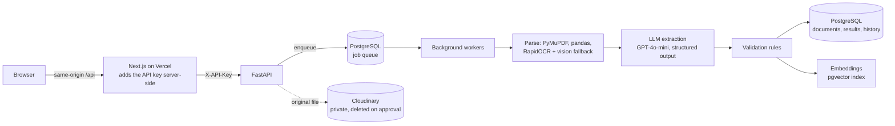

# DocuIntel: AI document intelligence for invoices

DocuIntel takes business documents (digital and scanned PDFs, JPG/PNG/TIFF images, Excel and CSV files), reads them, extracts the
invoice data as structured JSON, checks the arithmetic, flags what a person should look at, and makes everything searchable.
It can also **cross-verify** two documents (PDF against PDF, or PDF against an Excel/CSV ledger) and report which invoices disagree.

| | |
|---|---|
| **Backend** (this repository) | Python, FastAPI, PostgreSQL + pgvector, LangChain + OpenAI |
| **Frontend** | Next.js, React, Redux Toolkit: [mmiskatul/DocuIntel-frontend](https://github.com/mmiskatul/DocuIntel-frontend) |
| **Hosted frontend** | https://docuintel-five.vercel.app |

> **About the hosted demo.** The website is on Vercel, but its backend runs on the author's own computer behind a tunnel, so it can be
> offline. The reliable way to try the project is to run it yourself: it takes about five minutes (see [Quick start](#quick-start)).

---

## Contents

1. [What it does](#what-it-does)
2. [Architecture and design decisions](#architecture-and-design-decisions)
3. [Quick start](#quick-start)
4. [Configuration](#configuration)
5. [Using the API](#using-the-api)
6. [How a document is processed](#how-a-document-is-processed)
7. [Validation rules](#validation-rules)
8. [Testing and evaluation](#testing-and-evaluation)
9. [Security](#security)
10. [Known limitations](#known-limitations)
11. [AI prompts and disclosure of AI-assisted development](#ai-prompts-and-disclosure-of-ai-assisted-development)
12. [Repository layout](#repository-layout)

---

## What it does

How each part of the assignment is covered:

| Task | What was built |
|---|---|
| **1. Document processing** | Accepts many files at once: PDF, JPG, JPEG, PNG, TIFF, WEBP, XLSX, XLS, CSV. Digital PDFs are read with PyMuPDF. Scanned PDFs and images go through **local OCR** (RapidOCR) first, and a GPT-4o-mini vision call re-reads a page only when the local result is not confident (below 0.80). Spreadsheets are parsed with pandas/openpyxl/xlrd, every sheet. Multi-page PDFs, poor images, empty and corrupted files each end in a clear, specific status instead of a crash. A 1,000-page digital PDF is parsed in well under a second. |
| **2. AI extraction** | Invoice number, date, supplier, customer, subtotal, tax, total, currency and line items, returned as validated JSON (Pydantic schema, temperature 0). Anything missing or uncertain is `null`, never guessed. A PDF that holds several invoices is split by invoice number, with one result per invoice. A spreadsheet whose rows are invoices (a ledger) is parsed deterministically, without the LLM. |
| **3. Validation** | 19 rules: missing fields, bad or negative numbers, duplicate invoices, line-item arithmetic, and subtotal + tax versus total. Anything suspicious is set to `needs_review` with a code and a plain message. See [Validation rules](#validation-rules). |
| **4. Backend API** | REST endpoints for upload, status, results, search, manual corrections, approval/rejection and failed-job reprocessing. Slow OCR and AI work runs in a **durable background queue** that survives restarts. |
| **5. Database and search** | PostgreSQL tables for documents, extracted text, structured results, validation errors and processing history. **Keyword** search, **semantic** search (pgvector) and a **hybrid** mode that merges both. A question-answering endpoint cites its sources. |
| **6. Frontend** | Upload many files, watch progress, inspect extracted values next to the original page, review and correct errors, search, and cross-verify two documents. |
| **7. Testing and evaluation** | See [Testing and evaluation](#testing-and-evaluation). |
| **Cross-verification** | PDF to PDF and PDF to Excel/CSV: invoices are matched by invoice number, and supplier, customer, date, currency, subtotal, tax and total are compared. |

---

## Architecture and design decisions



The full diagram and the database schema (tables, columns, indexes) are in [`ARCHITECTURE_AND_SCHEMA.md`](ARCHITECTURE_AND_SCHEMA.md).

| Decision | Why | Trade-off |
|---|---|---|
| **PostgreSQL as the job queue** instead of Redis/BullMQ | One service fewer to run and back up. Jobs are claimed with `FOR UPDATE SKIP LOCKED`, workers send heartbeats, and a stalled job is re-queued automatically, so no job is lost or run twice. | Lower raw throughput than Redis. Fine for document processing, where each job takes seconds. |
| **pgvector** instead of a separate vector database | Documents, results and embeddings share one database and one backup. HNSW index on 384-dimension embeddings. | Not built for billions of vectors. |
| **Local OCR first**, LLM vision only as a fallback | Faster (about 0.6 s per page), free, and the document does not leave the server for clean scans. | A poor scan costs one extra LLM call. |
| **Structured output with explicit `null`s** | The model is told to leave a field empty rather than guess, and the validators then check the numbers deterministically. | Some valid-but-unusual layouts end in review instead of auto-approval. |
| **Next.js route as an API proxy** | The browser never sees the API key, and there is no CORS problem. | Requests pass through one extra hop. |
| **Originals kept in Cloudinary only while a document awaits review** | Large files stay out of the database. The file is deleted when the document is approved. | A deleted original cannot be read again (the extracted data stays). If Cloudinary is not configured, the file is kept in the database instead. |

---

## Quick start

**You need:** Python 3.11 or newer (developed and tested on 3.13), Node.js 20 or newer, a PostgreSQL database with the `pgvector` extension
([Supabase](https://supabase.com) works out of the box), and an OpenAI API key. Cloudinary is optional.

### 1. Backend

```bash
git clone https://github.com/mmiskatul/DocuIntel-backend.git
cd DocuIntel-backend

python -m venv .venv
# Windows:   .venv\Scripts\activate
# macOS/Linux: source .venv/bin/activate

pip install -r requirements.txt
cp .env.example .env        # Windows: copy .env.example .env
```

Open `.env` and set at least `DATABASE_URL`, `OPENAI_API_KEY` and `API_KEY` (create a key with
`python -c "import secrets; print(secrets.token_urlsafe(32))"`). Then start the server:

```bash
python -m uvicorn app.main:app --host 0.0.0.0 --port 8000
```

The tables and the vector index are created automatically on first start. Check it at http://localhost:8000/health and explore the
API at http://localhost:8000/docs.

### 2. Frontend

```bash
git clone https://github.com/mmiskatul/DocuIntel-frontend.git
cd DocuIntel-frontend
npm install
```

Create `.env.local`:

```
BACKEND_URL=http://localhost:8000
BACKEND_API_KEY=<the same value as API_KEY in the backend .env>
```

```bash
npm run dev          # http://localhost:3000
```

### Docker (backend only)

```bash
docker build -t docuintel-backend .
docker run --env-file .env -p 8000:8000 docuintel-backend     # or: docker compose up --build
```

> The Docker files are included but **have not been built or tested** by the author. The commands above are the tested path.

---

## Configuration

Set in `.env` (see [`.env.example`](.env.example)). Only the first three are required.

| Variable | Default | Meaning |
|---|---|---|
| `DATABASE_URL` | none | PostgreSQL connection string (with pgvector). |
| `OPENAI_API_KEY` | none | Used for extraction, vision OCR fallback, embeddings and answers. |
| `API_KEY` | empty | If set, every `/api` request must send it. Empty means no authentication (development only; a warning is logged). |
| `CORS_ORIGINS` | `http://localhost:3000` | Websites allowed to call the API, comma-separated. |
| `CLOUDINARY_URL` | empty | Optional. Keeps originals in private Cloudinary storage until approval. Or set `CLOUDINARY_CLOUD_NAME`, `CLOUDINARY_API_KEY`, `CLOUDINARY_API_SECRET`. |
| `MAX_UPLOAD_MB` / `MAX_FILES_PER_REQUEST` | `100` / `50` | Upload limits. |
| `WORKER_CONCURRENCY` | `3` | Documents processed at once. Use `1` on a small server. |
| `EXTRACTION_PARALLELISM` | `4` | Invoices extracted at once inside one document. |
| `DB_POOL_MAX` / `DB_POOL_WAIT_SECONDS` | `12` / `30` | Database connections, and how long a request waits for a free one. |
| `OCR_ENGINE` | `auto` | `auto`: local OCR first, vision model if unsure. `local`: never call the LLM for OCR. `vision`: LLM only. |
| `OCR_MIN_CONFIDENCE` | `0.80` | Below this local OCR confidence, the vision model re-reads the page. |
| `MAX_OCR_PAGES` | `100` | Page cap for scanned documents. |
| `MAX_INDEX_CHUNKS` | `200` | Cap on text chunks embedded per document. |
| `MAX_INVOICES_PER_DOCUMENT` | `500` | Cap on invoices split out of one file. |
| `EXTRACT_HEAD_CHARS` / `EXTRACT_TAIL_CHARS` | `6000` / `4000` | How much of each invoice's text the LLM reads (start and end). |
| `STALE_JOB_SECONDS` | `120` | A job with no heartbeat for this long is re-queued. |

---

## Using the API

Every route is available under both `/api/...` and `/api/v1/...`. Send the key in a header (`Authorization: Bearer <key>` also works).
`GET /health` is public.

```bash
KEY=your-api-key

# upload several files at once (returns 202 and the new document ids)
curl -H "X-API-Key: $KEY" -F "files=@invoice.pdf" -F "files=@ledger.xlsx" http://localhost:8000/api/v1/documents

# progress, then the extracted data
curl -H "X-API-Key: $KEY" http://localhost:8000/api/v1/documents/<id>/status
curl -H "X-API-Key: $KEY" http://localhost:8000/api/v1/documents/<id>/results

# search (keyword | semantic | hybrid) and a question with cited sources
curl -H "X-API-Key: $KEY" "http://localhost:8000/api/v1/search?q=Northwind&mode=hybrid"
curl -H "X-API-Key: $KEY" "http://localhost:8000/api/v1/search/rag?q=Which+suppliers+invoiced+us?"
```

| Method and path | Purpose |
|---|---|
| `POST /documents` | Upload one or many files (`multipart/form-data`, field `files`). |
| `GET /documents` | List documents. Query: `q` (file name, supplier, invoice number, extracted text), `status`, `limit`, `offset`. |
| `GET /documents/{id}` | One document with its summary. |
| `GET /documents/{id}/status` | Status, stage and progress. Statuses: `queued`, `processing`, `completed`, `needs_review`, `failed`, `rejected`. |
| `GET /documents/{id}/results` | Extracted invoices with validation issues and confidence. |
| `GET /documents/{id}/history` | Processing history (audit trail). |
| `GET /documents/{id}/file` | The original file, while it is still stored. |
| `GET /documents/{id}/page/{n}/image` | Page `n` of the original drawn as a PNG (used by the preview). |
| `POST /documents/{id}/correct` | Manual correction of extracted values (optionally for one invoice of a multi-invoice file). |
| `POST /documents/{id}/approve`, `/reject`, `/reconcile` | Review decisions. Approving also indexes the document for search and deletes its stored original. |
| `POST /documents/{id}/reprocess` | Re-run a document (aliases `/retry`, `/re-ocr`). `POST /documents/reprocess-failed` re-queues every failed one. |
| `POST /documents/cross-verify` | Compare two documents: `{"left_document_id": "...", "right_document_id": "...", "flag_mismatches": false}`. |
| `DELETE /documents/{id}` | Delete a document, its data and its stored original. |
| `GET /search?q=&mode=&limit=` | Keyword, semantic or hybrid search. |
| `GET /search/rag?q=` | Answer a question from the documents, with citations. |
| `GET /stats` | Counts by status, average processing time. |

---

## How a document is processed

1. **Upload.** The file is validated (type, size, count) and stored. The request returns `202` immediately.
2. **Queue.** A job row is written to PostgreSQL. A worker claims it, sends heartbeats, and finishes it. If the server stops, the job is recovered on restart.
3. **Read.** Digital PDFs give text directly. A scanned PDF or an image goes through local OCR; unsure pages are re-read by the vision model, and unreadable text is marked `[illegible]` instead of guessed. Spreadsheets are read sheet by sheet.
4. **Split.** A PDF containing several invoices is split by invoice number. A spreadsheet that is a ledger is parsed row by row without the LLM.
5. **Extract.** The LLM returns the structured fields, with `null` for anything it cannot support from the text.
6. **Validate.** Deterministic rules check the data (see below). Duplicates are detected across documents.
7. **Save.** Results, issues, a confidence score and a history entry are stored. Status becomes `completed`, `needs_review`, `rejected` (not a billing document) or `failed` (unreadable or corrupted, with the reason).
8. **Index.** Once a document is verified (it passed validation, or a reviewer approved it), its text is embedded so it appears in semantic search and in answers. A document that still needs review is held out of those until a person approves it, but keyword search and the document list always find it.

The confidence score is a heuristic (how many key fields were found, capped by OCR quality, reduced when flagged), not a model probability.

---

## Validation rules

| Check | Codes |
|---|---|
| Missing fields | `MISSING_INVOICE_NUMBER`, `MISSING_INVOICE_DATE`, `MISSING_SUPPLIER_NAME`, `MISSING_CUSTOMER_NAME`, `MISSING_SUBTOTAL`, `MISSING_TOTAL` |
| Incorrect numbers | `INVALID_NUMERIC_VALUE`, `NEGATIVE_SUBTOTAL`, `NEGATIVE_TAX`, `NEGATIVE_TOTAL`, `NEGATIVE_LINE_AMOUNT`, `NEGATIVE_UNIT_PRICE`, `INVALID_QUANTITY`, `ZERO_TOTAL_WITH_ITEMS` |
| Duplicates | `DUPLICATE_INVOICE` (same invoice number and supplier, in another document) |
| Inconsistent amounts | `TOTAL_MISMATCH` (subtotal + tax does not equal the total), `LINE_ITEMS_SUBTOTAL_MISMATCH`, `LINE_ITEMS_TOTAL_MISMATCH`, `LINE_ITEM_ARITHMETIC_ERROR` (quantity x price does not equal the line amount) |
| Reading quality | `LOW_OCR_QUALITY` (a scan that could not be read reliably) |

Amounts within 0.05 are treated as equal. Messages quote the invoice's own currency.

---

## Testing and evaluation

```bash
pip install pytest
pytest tests                          # backend: needs DATABASE_URL and OPENAI_API_KEY, takes about 12 minutes
python tests/evaluate_benchmark.py    # the labelled benchmark on its own
```

> **Stop any other backend that uses the same database before running the tests.** The job-recovery tests plant "abandoned" jobs on purpose,
> and a second running server would (correctly) recover them and make a test fail.

The frontend has its own tests: `npm test` in the frontend repository (41 tests, about a second, no backend needed).

**Latest results (2026-10-31):** backend 97 tests. The first full run was **94 passed, 0 failed** (11 min 40 s). After 3 tests were added for a bug that run
revealed, the final full run was **96 passed, 1 failed**; the one failure was a recovery test disturbed by a second server on the same database, and it passes
on its own. Frontend: **41 passed, 0 failed**. A table of every test file and what it covers is in [`EVALUATION_REPORT.md`](EVALUATION_REPORT.md).

The backend tests cover document parsing (PDF, image, Excel, CSV), OCR routing, AI extraction, validation, the REST endpoints and their filters, upload
limits, API-key authentication, crash recovery of jobs, multi-invoice splitting, cross-verification, search, original-file storage, and failure scenarios
(corrupt and empty files, an LLM outage). They run against the real database and the real OpenAI API, and each test creates and deletes only its own
documents.

**Measured benchmark** (7 labelled documents, measured before the latest changes and re-run inside the suite above, where it met its thresholds): 100%
extraction accuracy on the 5 valid documents, 100% success on valid documents, 0% failure on valid documents, mean processing time 10.9 s per document;
the corrupt file and the non-invoice were handled correctly. Per-document times, the OCR measurements and the caveats are in the evaluation report.
That benchmark is small and synthetic, so treat it as a smoke test rather than a claim about real-world accuracy.

---

## Security

- **Authentication:** a shared API key, compared in constant time. The website's server-side proxy attaches it, so it never reaches the browser.
- **CORS:** only the origins in `CORS_ORIGINS` may call the API from a browser.
- **Uploads:** file-type allow-list by extension, size and count limits, empty and corrupt files rejected with a clear reason.
- **Database:** every value in a query is a bound parameter (values are never pasted into SQL text).
- **Secrets:** only in `.env`, which is git-ignored. The repository history has been scanned and contains no credentials.
- **Stored originals:** Cloudinary assets are `authenticated` (no public URL) and are fetched with signed URLs. They are deleted on approval.

Not included: per-user accounts and roles, rate limiting, and content-based file-type detection. A single shared key is the access control.

---

## Known limitations

- **Scanned documents are capped at 100 OCR pages** (`MAX_OCR_PAGES`). A 1,000-page *digital* PDF is fine; a 1,000-page *scanned* one was not tested.
- **No load test.** Throughput was exercised with three parallel workers only. The queue is designed to be safe with several server processes, which was verified with concurrent recovery sweeps but not with two real servers.
- **Small evaluation set.** Line-item accuracy is not scored, and poor-quality scans are the weakest area; the system flags unreliable reads for review rather than trusting them.
- **Redis/BullMQ is not used** (see the design decisions above).
- **Hosting.** The author's demo backend runs on a laptop. The free hosting tried (512 MB of memory) was too small for the OCR model.
- **Cross-verification** matches invoices by invoice number only. Invoices without a number cannot be matched. Ambiguous `dd/mm` and `mm/dd` dates are read day-first.

---

## AI prompts and disclosure of AI-assisted development

### Prompts the application sends to the model

All calls use OpenAI `gpt-4o-mini` (extraction, vision OCR, answers) and `text-embedding-3-small` at 384 dimensions (search).
The prompts below are quoted from the source code.

<details>
<summary><b>1. Extraction</b> (<code>app/services/extractor.py</code>, temperature 0, structured output)</summary>

```text
SYSTEM:
You are an enterprise AI Document Intelligence and Financial Extraction Engine.

MANDATORY REQUIREMENT:
Extract invoice number, invoice date, supplier name, customer name, subtotal, tax, total, currency, and line items. Return structured JSON and handle missing or uncertain information without inventing values.

CRITICAL EXTRACTION & ANTI-HALLUCINATION RULES:
1. STRICT FACTUALITY (ZERO HALLUCINATION):
   - Extract ONLY values explicitly present in the source text.
   - NEVER invent, fabricate, guess, or extrapolate values.
   - If any field (invoice_number, invoice_date, supplier_name, customer_name, subtotal, tax, total) is missing, ambiguous, or uncertain in the source document, you MUST set that field to null.
   - If line items are not present or cannot be parsed with certainty, return an empty array []. DO NOT create dummy items.

2. DYNAMIC DOCUMENT CLASSIFICATION & FORMAT VALIDATION:
   - Carefully analyze the actual content of the text to identify what type of document it truly is.
   - If the document is a valid commercial billing document (Invoice, Commercial Receipt, Freight Waybill, Bill of Lading, Purchase Order, Utility Bill):
     Set is_supported_format=True, rejection_reason=null, and extract all stated fields.
   - If the document is NOT a billing document (for example: a Resume/CV, Legal Contract, Academic Article, Engineering Spec, Medical Record, Product Manual, Personal Letter, Assignment Task, etc.):
     Set is_supported_format=False.
     Dynamically construct a clear, specific rejection_reason explaining what the document actually is and what it lacks. [examples for a CV, a contract, a research article, a medical record and a project brief follow in the source]
     When is_supported_format is False, all financial fields (invoice_number, subtotal, tax, total, customer_name, line_items) MUST be null or empty.

3. NUMERIC FIELDS:
   - subtotal, tax, and total must be raw float numbers (e.g., 2890.00, not '$2,890.00').
   - If tax is not specified or 0, set tax to 0.0 or null. DO NOT guess tax rates.

HUMAN:
Filename: {filename}

Document Text:
{text}
```

Every field in the output schema also carries its own instruction, for example: "Return null if missing, uncertain, or not explicitly stated. DO NOT calculate or invent."
</details>

<details>
<summary><b>2. Vision OCR fallback</b> (<code>app/services/vision_ocr.py</code>)</summary>

```text
SYSTEM:
You are a professional OCR engine. Transcribe all text, numbers, labels, and tables visible in this document accurately. Maintain table rows and column layouts. Transcribe exactly what is printed; never guess, complete, or infer text. If any word or number is blurry, faded, cut off, or otherwise not clearly legible, write [illegible] in its place instead of guessing. Output the transcription only, with no commentary or code fences.

HUMAN (with the page image):
Extract all readable text, line items, and key-value fields from this document image:
```
</details>

<details>
<summary><b>3. Question answering</b> (<code>app/services/rag_service.py</code>)</summary>

```text
SYSTEM:
You are a professional Document Intelligence Assistant. Answer the user query concisely and accurately based ONLY on the provided context snippets. Cite the source document filenames whenever stating facts or amounts.

HUMAN:
Context:
{context}

Question: {question}
```
</details>

### Disclosure of AI-assisted development

This project was built with AI coding assistants, and the author wants that to be clear:

- **Google Antigravity** and other LLM pair-programming assistants were used in the early stages for scaffolding, synthetic test-data creation and refactoring (as recorded by the author in the first version of this README).
- **Claude Code (Anthropic)** was used extensively in the later stages of this repository: implementing and debugging features (the durable job queue, local OCR, multi-invoice and ledger handling, cross-verification, the Cloudinary storage, the React/Redux interface), writing the automated tests and the benchmark, running the measurements reported in `EVALUATION_REPORT.md`, and writing this documentation.
- **In the running application**, the AI models are `gpt-4o-mini` and `text-embedding-3-small` (OpenAI), used only as described above.

The author set the requirements, ran the application and decided what to keep. As with any AI-assisted code, it may still contain mistakes: the
behaviour described here was checked by running the code (tests and the measurements in `EVALUATION_REPORT.md`), not assumed.

Guardrails against invented data: the extraction schema defaults every field to `null`, the prompt forbids guessing, unreadable OCR text is
marked `[illegible]`, and separate deterministic code re-checks every amount instead of trusting the model.

---

## Repository layout

```
app/
  main.py               FastAPI app, CORS, startup
  config.py             settings (from environment / .env)
  api/                  routes: documents, search, stats, health
  core/                 database pool and schema, API-key security
  models/               database access (documents, results, embeddings)
  services/
    extractor.py        text extraction + LLM structured extraction
    pipeline.py         the processing pipeline, confidence, multi-invoice, ledgers
    job_queue.py        durable queue, heartbeats, crash recovery
    local_ocr.py        RapidOCR + post-processing
    vision_ocr.py       vision-model OCR fallback
    spreadsheet.py      Excel/CSV parsing and ledger detection
    segmenter.py        splits a PDF into invoices
    validator.py        validation rules
    cross_verify.py     PDF-to-PDF / PDF-to-Excel comparison
    rag_service.py      embeddings, semantic search, answers
    search_service.py   keyword, semantic and hybrid search
    cloud_storage.py    private Cloudinary storage for originals
    page_render.py      draws a page of the original as a PNG
ARCHITECTURE_AND_SCHEMA.md   diagram and database schema
EVALUATION_REPORT.md         measured results
```
